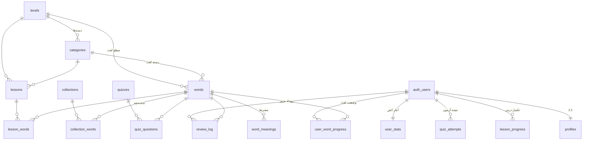

# ساختار جداول (PostgreSQL)

دو دنیای کاملاً جدا: **محتوا** (عمومی، فقط‌خواندنی از سمت کلاینت) و **کاربر** (خصوصی، RLS).

## ERD

## جداول محتوا (migrations/00001)

| جدول | ستون‌های کلیدی | نکته |
|---|---|---|
| `levels` | `id text PK ('A1'..'C2')`, `sort_order` | سطح جدید = یک INSERT |
| `categories` | `(level_id,key) UNIQUE`, `sort_order` | دسته‌بندی حرفه‌ای درون سطح |
| `words` | `(word,pos) UNIQUE`, FK سطح+دسته، `difficulty 1..5` | هر لغت فقط در یک سطح |
| `word_meanings` | FK word، `UNIQUE(word_id,sort_order)` | معنی‌های چندگانه، بدون تکرار داده |
| `collections` + `collection_words` | PK مرکب | **چند‌به‌چند**؛ لغت هم در سطح هست هم در مجموعه |
| `quizzes`, `quiz_questions` | options jsonb | اختیاری؛ اپ آزمون را روی دستگاه می‌سازد |
| `content_packs` | `version PK`, `is_active` (unique partial index) | بررسی نسخه با **یک ردیف** |

## جداول کاربر (migrations/00002 + 00004 + 00005)

| جدول | نقش | نوشتن | همگام‌سازی |
|---|---|---|---|
| `profiles` | پروفایل ۱:۱ با auth.users | trigger ثبت‌نام + خود کاربر | خودکار |
| `user_word_progress` | **وضعیت** هر لغت per کاربر | upsert کلاینت | LWW trigger (00005) |
| `review_log` | **رویداد** append-only | فقط INSERT کلاینت | idempotent با `client_event_id` |
| `lesson_progress` | وضعیت درس | upsert | LWW |
| `quiz_attempts` | رویداد خلاصه آزمون | فقط INSERT | idempotent |
| `user_stats` | **کش تجمیعی** | فقط trigger ها (definer) | pull توسط اپ |
| `v_user_daily_activity` | VIEW مشتق از review_log | — | نه؛ همیشه درست است |

### ستون‌های SRS در user_word_progress
`ease_factor (1.3..3.0)` · `interval_days` · `repetitions` · `due_at` — همان مدل SM-2.
اپ فعلی SRS-lite را روی دستگاه اجرا می‌کند؛ ارتقا به FSRS بدون ALTER TABLE.

### چرا user_stats «کش» است؟
منبع حقیقت = `review_log` + `user_word_progress`. آمار با trigger ها به‌روز می‌شود تا
اپ برای هدر پروفایل COUNT سنگین نزند. اگر خراب شد: `select recalc_user_stats(auth.uid());`
(فقط برای خودش — تابع چک می‌کند).

## ایندکس‌های مهم

- `user_word_progress`: PK `(user_id,word_id)` · `(user_id,due_at) WHERE status<>'new'` (صف مرور) · `(user_id,status)`
- `review_log`: `UNIQUE(user_id,client_event_id)` (idempotency) · `(user_id,created_at DESC)` · `(user_id,word_id)`
- `words`: `UNIQUE(word,pos)` · `(level_id,category_id,id)`
- `collection_words`: PK مرکب + ایندکس معکوس `(word_id)`

## قراردادها

- زمان‌ها `timestamptz`؛ استریک بر اساس تاریخ UTC (آفست تایم‌زون کاربر در `profiles.tz_offset_minutes` برای فاز ۲)
- شناسه رویدادها `uuid` تولیدشده **روی دستگاه** (`gen_random_uuid()` سمت سرور فقط fallback)
- حذف کاربر: `on delete cascade` از auth.users → پاک‌سازی کامل خودکار
